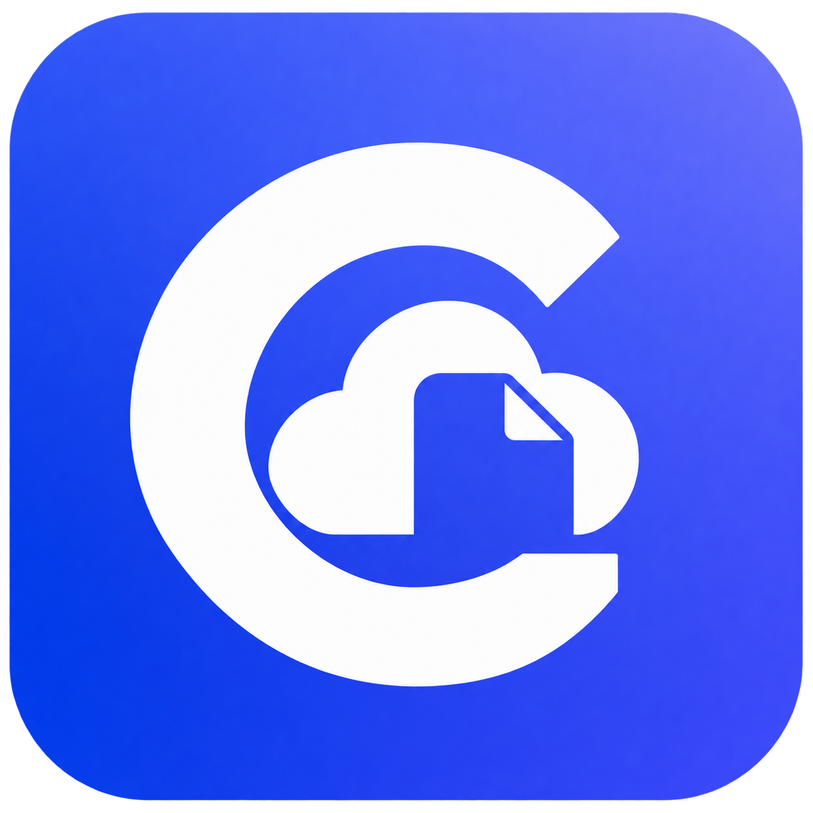
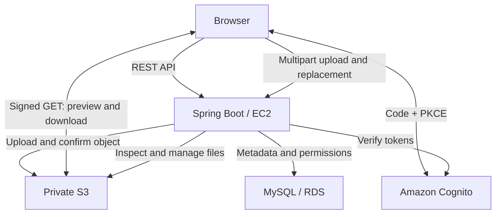

# CloudDocs

Document management, internal sharing and departmental task workflows on AWS.

## Contents

- [Implemented features](#implemented-features)
- [Permissions](#permissions)
- [Architecture](#architecture)
- [Local setup](#local-setup)
- [Configuration](#configuration)
- [Migrations and database tools](#migrations-and-database-tools)
- [APIs and verification](#apis-and-verification)
- [AWS deployment](#aws-deployment)

[Tiếng Việt](README.md) | **English**

Enterprise document management built with Java 21, Spring Boot 3.5.6, MySQL, vanilla JavaScript and AWS. CloudDocs combines private S3 storage, Cognito authentication, departmental access and task/report workflows.

## Implemented features

Tasks, Trash, Received shares, Sent shares, Recent and Favorites use client-side pagination with 20 rows per page after search/filter/sort. Users and Audit history also paginate in groups of 20 when more than 20 records exist. Select-all covers only actionable rows on the current page. Sent shares selects recipient grants and supports bulk revocation. Dashboard summaries show at most 5 documents and 5 recent activities, with “View all” links and no pagination.

### Actions by page

Section navigation uses URLs such as `index.html#/documents`, `#/favorites` and `#/profile`. Browser Back/Forward traverses previously opened sections; reloading or opening a direct URL restores that section while the login session remains valid. Re-selecting the same section does not add a duplicate history entry. This works locally and on EC2 without web-server path-rewrite rules. Access checks remain in place: USER accounts cannot open administration pages through URLs or old history entries. URLs currently preserve the section only, not filters, page numbers or nested folders.

The same interface rules apply to ADMIN, MANAGER and USER; the backend still checks each document's permissions.

| Page | Actions |
| --- | --- |
| Documents | Preview, download, favorite; edit when permitted; owners/ADMIN may share and move files to Trash, individually or in batches. |
| Recent | Preview, download when permitted, favorite/unfavorite; no deletion or bulk sharing. |
| Favorites | Remove from favorites, preview and download when permitted; removing a favorite does not delete the document. |
| Received shares | Preview, download and edit when permitted; no original-file deletion or onward sharing. |
| Dashboard | Favorite, preview and download when permitted; open the full list using “View all”. |
| Trash | Restore or permanently delete when permitted, individually or in batches. |

Collections support bulk downloading only when every selected file allows downloading. Pagination operates on lists already loaded in the browser, rather than database queries. Changing filters/scope returns to the first page; shrinking a list clamps the current page to an existing page. The “Remove from favorites” button expands to fit its label. Collections accept only the latest load result for the current login session.

Uploads use `POST /api/documents/upload` with multipart `file`, `metadata`, `requestId` (UUID), and optional `folderId`. The backend commits metadata only after S3 upload/confirmation succeeds; failures roll back and attempt object cleanup. Account-scoped request IDs make retries after lost responses idempotent. The interface retries only incomplete files. Legacy metadata-only creation and presigned-upload endpoints reject requests and ask clients to reload. Existing invalid legacy records are not automatically deleted without checking their S3 objects.

The Documents table has no status column. Client-side pagination shows 20 combined folders/files per page after search/filter/sort; select-all applies only to files on the current page. The backend still returns the full list. Internal trash and workflow statuses are retained.

The upload dialog only needs files and an optional description. The backend derives the department from the account profile and retains filenames. Uploads go into the current owned folder, or the root when browsing another account's folder.

Document column headers cycle through name A–Z/default, newest/oldest/default, largest/smallest/default. Folders stay above files and sort by item count for size. Sorting does not change stored statuses or data.

Documents uses one table for folders and files, with folders first, a 📁 icon and a direct-child item count. Search/department filters apply to both; format filters apply only to files. Breadcrumbs remain above the table. A folder's update column shows its latest direct file update, or a dash when unavailable.

**Document folders:** create folders/subfolders, rename, move one or multiple files, automatically upload into the current folder and navigate with breadcrumbs. Each account manages its own folder tree; department/shared access does not allow organizing another owner's files. Moving retains S3 keys, shares and favorites. Deleting a folder sends files throughout its subtree to Trash; individual restoration returns them to the root. A protected report aborts the entire deletion.

| Area | Capabilities |
| --- | --- |
| Authentication and profile | Cognito Authorization Code + PKCE; full names; profile updates; JPG/PNG avatars up to 5 MiB, normalized to 256 × 256 squares. |
| Documents | Upload up to 100 MiB/file; infer format from extension; search, filter, preview, download; edit metadata with optional content replacement. |
| Bulk actions | Documents supports sharing, downloading and moving to Trash; collections support downloading only. Individual outcomes on partial failures. |
| Sharing | View/download/edit permissions; Received and Sent shares; recipient, department and permission filters; change/revoke access directly. |
| Trash | Soft deletion, restore and permanent deletion, individually or in batches; audit history. |
| Collections | Recent documents and favorites; audit favorite/unfavorite actions. |
| Tasks | Assign work, deadlines, start progress, document reports, notes, change requests and approval; overdue/late status; bulk selection/deletion. |
| Storage | Dedicated management page; usage/quota, format chart, largest files first, trash statistics. Admin sees system totals with 1 TB quota; USER/MANAGER default to 100 GB. |
| Administration | Accounts, roles and status; create/rename/disable/delete departments and assign staff; global announcements. |
| Audit and notifications | Full names and actions; private task notifications; admin can delete global announcements. |
| Interface | Responsive layouts; Search button/Enter; refresh lists; logo navigates to dashboard. |

## Permissions

### Sign-in and sign-out

The interface disables Sign in while checking the session or redirecting, and enables it only when the check finishes. Sign-out immediately clears the CloudDocs session and displayed account data, allows up to 1.5 seconds for the audit request, then navigates through Cognito's `/logout` endpoint to clear its login cookie. Sign in stays disabled during this transition. Old session-check responses cannot reopen the application after sign-out. Returning with the browser Back button triggers session validation before allowing interaction.

Reopening the website with a valid CloudDocs session may restore the account without another password prompt. The CloudDocs session and Cognito login cookie are separate; clearing local tokens alone does not complete Cognito sign-out.

Admins can browse every account's folder tree with owner names and can rename/delete other accounts' folders. Creation, upload destinations and file organization remain owner-only. Folder deletion trashes files; restoring the entire folder tree is not supported. USER and MANAGER catalogs contain only their own folders; manager access to department documents continues independently.

| Scope | USER | MANAGER | ADMIN |
| --- | --- | --- | --- |
| Documents | Owned or explicitly shared | USER access plus viewing documents owned by current department members | Entire system |
| Assign tasks | Receive assignments | Assign to active USER accounts in own department | Assign to active USER/MANAGER accounts |
| Review reports | No | Own assignments | Own assignments |
| Audit history | Own actions | Own actions | System-wide |
| Manage roles, accounts, departments | No | No | Yes |

Only admins change roles. Employees may select an existing department when self-selection is allowed. Unassigned is a state, not a department. Manager scope follows the owner's current department, not the document's department label; it does not automatically grant edit/download/share/delete access.

Owners/admins manage shares and trash. VIEW allows preview; DOWNLOAD adds download; EDIT adds editing/replacement. Incoming-only shares appear in Received shares rather than the personal Documents library. Every backend request checks authorization.

## Architecture

- Backend: Spring Security, Spring Data JPA/Hibernate, Bean Validation, AWS SDK v2.
- Frontend: plain HTML/CSS/JavaScript, without an npm build step.
- MySQL 8 stores metadata, permissions, profiles, tasks and audit events; Amazon RDS is supported.
- Cognito identities link by issuer + sub, never by email.
- Private S3 stores files; EC2 runs the backend, with HTTPS/reverse proxy for the frontend.



Regular uploads and replacements pass through the backend; the browser no longer sends direct S3 PUT requests in the current upload flow. New uploads use one database transaction, a separate S3 key for each attempt and object confirmation before commit. Replacements retain document ID, ownership, shares and favorites. Avatars are stored in the database. Uploads no longer depend on S3 CORS; direct signed-URL preview/download still requires matching CORS. Proxies must allow multipart requests up to 101 MiB (100 MiB files plus form overhead). S3 and the database do not share a distributed transaction: failed object cleanup requires checking orphan objects using the logs.

## Repository layout

| Path | Contents |
| --- | --- |
| [Back_end/src/main](Back_end/src/main) | Backend and configuration |
| [Back_end/src/test](Back_end/src/test) | Backend tests |
| [Back_end/db/migration](Back_end/db/migration) | Ordered migrations |
| [Back_end/db](Back_end/db) | Diagnostics, admin bootstrap, optional duplicate-audit cleanup |
| [Back_end/aws/s3](Back_end/aws/s3) | IAM/CORS templates and bucket setup/check script |
| [FrontEnd](FrontEnd) | Interface, assets and tests |
| [scripts](scripts) | Local launch and Cognito diagnostic tools |

## Local setup

Install JDK 21, Maven 3.9+, Node.js 20+ and MySQL 8. Prepare a Cognito public app client with Code + PKCE, a private S3 bucket and backend AWS credentials.

**Database prerequisite:** this repository contains incremental migrations, not a complete base-schema installer for an empty database. Import the existing business schema (users, documents, audit_logs, etc.), inspect its state, then apply missing migrations. The application uses ddl-auto=validate and does not run migrations automatically.

From the repository root:

```powershell
mvn -f Back_end/pom.xml clean package
./scripts/start-local-backend.ps1 -DatabaseHost localhost -DatabasePort 3306 -DatabaseName company_documents -DatabaseUser root
```

The launcher prompts for the MySQL password without displaying it and uses the existing development Cognito configuration. For another pool, configure the environment and run the JAR directly:

```powershell
java -jar Back_end/target/clouddocs-backend-0.0.1-SNAPSHOT.jar --spring.profiles.active=local
```

In another terminal:

```powershell
node scripts/serve-frontend.cjs
```

Open the printed URL, normally http://127.0.0.1:5500/FrontEnd/index.html; do not use file://. Backend health: http://localhost:8080/api/health. Rebuild and restart Java after backend changes.

First admin: log in through Cognito once, then review and fill the exact account in [bootstrap-cognito-admin.sql](Back_end/db/bootstrap-cognito-admin.sql). It defaults to NULL targets and ROLLBACK to prevent accidental promotion.

## Configuration

| Environment variable | Meaning / default |
| --- | --- |
| DB_HOST, DB_PORT, DB_NAME | localhost, 3306, company_documents |
| DB_USERNAME, DB_PASSWORD | Actual MySQL credentials |
| SPRING_DATASOURCE_URL | Override JDBC URL, including deployment TLS settings |
| COGNITO_ISSUER_URI, COGNITO_CLIENT_ID | Issuer and public client from the same pool |
| COGNITO_USER_INFO_URI | Matching pool's UserInfo endpoint |
| COGNITO_NEW_USER_STATUS | ACTIVE or PENDING_APPROVAL; default ACTIVE |
| AWS_REGION, S3_BUCKET | Document bucket region and name |
| AWS_PROFILE | Optional local profile; standard SDK credential chain supported |
| S3_PRESIGN_EXPIRY | 900 seconds |
| CORS_ALLOWED_ORIGINS | Comma-separated frontend origins |
| STORAGE_USER_QUOTA_BYTES | 100000000000: 100 GB for USER/MANAGER |
| STORAGE_ADMIN_QUOTA_BYTES | 1000000000000: 1 TB admin/system quota |
| PORT | 8080 |

Set variables in the terminal, IDE or service; .env files are not loaded automatically. Update API_BASE in FrontEnd/js/app.js and public settings in [cognito-config.js](FrontEnd/js/cognito-config.js). Callback/logout URLs must match Cognito exactly. Cognito and S3 regions may differ. Never commit passwords, AWS secrets, tokens or client secrets. Prefer an EC2 IAM instance role. Development JDBC defaults do not enable TLS.

## Migrations and database tools

Back up and verify the target database. Apply only missing migrations after comparing the schema; MySQL DDL can implicitly commit.

| Order | Script |
| --- | --- |
| Inspect | [00_PRECHECK](Back_end/db/migration/00_PRECHECK.sql) |
| 01 | [Document permissions](Back_end/db/migration/01_APPLY_document_permissions.sql) |
| 02 | [Favorites](Back_end/db/migration/02_APPLY_document_favorites.sql) |
| 03 | [Notifications](Back_end/db/migration/03_APPLY_notifications.sql) |
| 04 | [Cognito identities](Back_end/db/migration/04_APPLY_cognito_identities.sql) |
| 05 | [Optional email](Back_end/db/migration/05_APPLY_optional_contact_email.sql) |
| 06 | [Work tasks](Back_end/db/migration/06_APPLY_work_tasks.sql) |
| 07 | [Departments and avatars](Back_end/db/migration/07_APPLY_departments_avatars.sql) |
| 08 | [Document folders](Back_end/db/migration/08_APPLY_document_folders.sql) |

Run migration 08 once before starting the updated backend. Existing documents remain at the root. Folder APIs: `GET/POST /api/folders`, `PUT/DELETE /api/folders/{id}`, `POST /api/folders/move` (`documentIds` plus `folderId`; `null` means root). Migration 08 is separate from the optional audit cleanup script under `Back_end/db`.

Manager access, Sent shares and file replacement require no migration after 07. Retained tools include [profile/storage diagnostics](Back_end/db/diagnose-profile-storage.sql) and [optional duplicate creation-log cleanup](Back_end/db/08_OPTIONAL_cleanup_duplicate_creation_logs.sql). Preview CREATE events with corresponding UPLOAD evidence before deciding whether to remove duplicates.

## APIs and verification

Business APIs require a Cognito Bearer access token. Main groups: /api/profile, /api/documents, /api/shares/sent, /api/departments, /api/users, /api/work-tasks, /api/storage, /api/audit-logs and /api/notifications. Controllers under Back_end/src/main define exact routes and payloads.

```powershell
mvn -f Back_end/pom.xml test
node --test FrontEnd/tests/*.test.cjs
```

After interface changes, check JavaScript syntax and rerun the Node tests. Regression cases cover page-specific actions for ADMIN/USER, unfavorite buttons, Users/Audit pagination, login-session changes and rapid collection navigation. Verify JAR packaging with `mvn -f Back_end/pom.xml package`. These are automated checks, not evidence that every live AWS workflow has been tested.

JUnit/Mockito/MockMvc and Node tests cover authorization, sharing, audits, storage, replacement, tasks and interface state. Mock-based tests do not replace real MySQL/RDS, Cognito redirect, S3 CORS or mobile-browser checks. Before handover, verify all three roles: upload/replace; sharing permissions/revocation; restore/purge; department assignment restrictions; late reports/review/change requests; storage totals and audit visibility.

## AWS deployment

1. Prepare RDS schema/migrations, connectivity, TLS and security groups.
2. Configure private S3, Block Public Access, encryption and least-privilege IAM. Review Back_end/aws/s3 templates before applying them; startup does not provision infrastructure.
3. Build the JAR; run the aws profile as an EC2 service with environment configuration and an IAM instance role.
4. Serve the frontend through HTTPS/reverse proxy; update API_BASE, Cognito callback/logout and backend/S3 CORS to the actual origins.
5. Allow 100 MiB uploads plus multipart overhead at the proxy, for example Nginx client_max_body_size 101m. Backend multipart request limit is 101 MB.
6. Check health and live business workflows before opening access.

The repository does not include CI/CD or complete automated EC2/RDS/Cognito provisioning.

## Operational behavior, limitations and troubleshooting

- Usage is metadata-based, including pending uploads and trash; shares charge the owner once. Dashboard distribution includes active files. This is not a physical S3 inventory, object-version count or AWS bill. GB/TB use decimal units.
- Trash retains shares for restoration; permanent deletion retains history. There is no scheduled trash cleanup. Previously issued signed URLs may remain usable until expiration after revocation.
- No file-version restoration interface is available. Failed S3 cleanup may require orphan-object handling.
- Task workflow: TODO → IN_PROGRESS → SUBMITTED → COMPLETED; change requests return to IN_PROGRESS. Late submission is recorded without automatic penalties. Submitted/approved report content is protected.
- Disabling departments prevents new selection; deleting clears existing department links. Existing task relationships remain. Deleting a task does not delete report files.
- Account deletion marks DELETED in the application, without deleting Cognito identities. The last admin and accounts with documents/open work are protected.
- One enterprise per deployment; no isolated multi-tenant database or reminder email delivery.

| Symptom | Check |
| --- | --- |
| MySQL Access denied | Credentials in the actual backend process; Workbench credentials are not inherited. |
| Unable to determine Dialect | Earlier SQLException; resolve connectivity/permissions/schema rather than masking the failure. |
| Missing table/column | Target database and migration state; do not bypass review with ddl-auto=update. |
| Cognito redirect failure | Exact callback/logout scheme, host, port and path. |
| S3 403/CORS | IAM, bucket/region, origin, URL expiration and bucket CORS. |
| Upload 413 | Proxy/backend limits and multipart overhead. |
| Manager cannot assign | Assigned department and active USER recipient in that department. |
| Stale running version | Hard-refresh frontend; rebuild and restart Java. |
