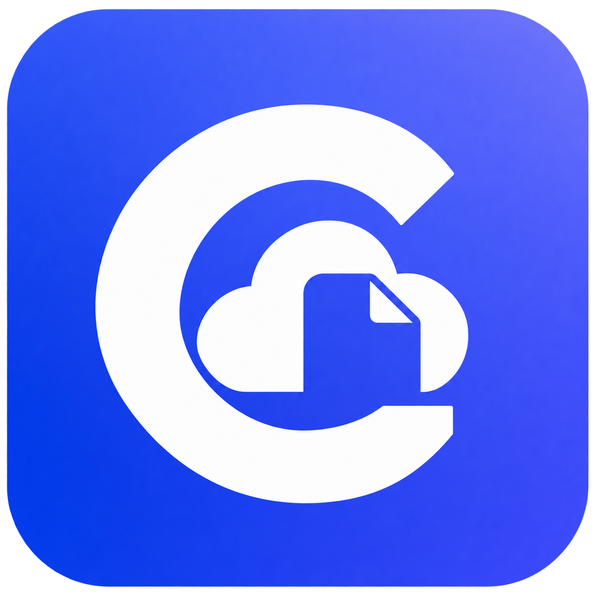
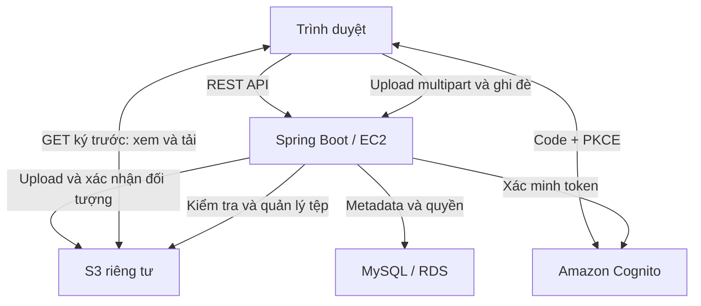

# CloudDocs

Quản lý tài liệu, chia sẻ nội bộ và giao việc theo phòng ban trên nền tảng AWS.

## Mục lục

- [Chức năng đã triển khai](#chức-năng-đã-triển-khai)
- [Phân quyền](#phân-quyền)
- [Kiến trúc](#kiến-trúc)
- [Chạy local](#chạy-local)
- [Cấu hình](#cấu-hình)
- [Migration và dữ liệu](#migration-và-dữ-liệu)
- [API và kiểm thử](#api-và-kiểm-thử)
- [Triển khai AWS](#triển-khai-aws)

**Tiếng Việt** | [English](README.en.md)

Ứng dụng quản lý tài liệu doanh nghiệp với Java 21, Spring Boot 3.5.6, MySQL, JavaScript thuần và AWS. Dự án kết hợp lưu trữ S3 riêng tư, đăng nhập Cognito, phân quyền phòng ban và giao việc, nộp báo cáo.

## Chức năng đã triển khai

Công việc, Thùng rác, Được chia sẻ, Đã chia sẻ, Gần đây và Yêu thích đều có phân trang giao diện 20 dòng/trang, sau tìm kiếm/lọc/sắp xếp. Người dùng và Nhật ký hoạt động cũng phân trang 20 dòng khi có nhiều hơn 20 bản ghi. Chọn tất cả chỉ áp dụng cho các dòng được phép thao tác trên trang đang xem. Đã chia sẻ chọn theo từng quyền cấp/người nhận và hỗ trợ thu hồi hàng loạt. Tổng quan chỉ hiển thị tối đa 5 tài liệu và 5 hoạt động gần nhất, có nút “Xem tất cả”, không phân trang.

### Thao tác theo từng trang

Điều hướng giữa các mục dùng địa chỉ dạng `index.html#/documents`, `#/favorites`, `#/profile`… Nút Quay lại/Tiến tới của trình duyệt quay giữa các mục đã mở; tải lại hoặc mở trực tiếp URL sẽ khôi phục mục tương ứng khi phiên đăng nhập còn hợp lệ. Bấm lại cùng mục không tạo lịch sử trùng. Cơ chế này hoạt động cả local lẫn EC2, không cần cấu hình rewrite đường dẫn cho web server. Quyền truy cập vẫn được kiểm tra; USER không mở được mục quản trị qua URL hoặc lịch sử cũ. URL chỉ lưu mục điều hướng, chưa lưu bộ lọc, số trang hay thư mục con.

Quy tắc giao diện áp dụng thống nhất cho ADMIN, MANAGER và USER; quyền trên từng tài liệu vẫn do backend kiểm tra.

| Trang | Thao tác |
| --- | --- |
| Tài liệu | Xem trước, tải xuống, yêu thích; sửa theo quyền; chủ sở hữu/ADMIN chia sẻ và chuyển vào thùng rác, từng tệp hoặc hàng loạt. |
| Gần đây | Xem trước, tải xuống theo quyền, thêm/bỏ yêu thích; không xóa hoặc chia sẻ hàng loạt. |
| Yêu thích | Bỏ yêu thích, xem trước và tải xuống theo quyền; bỏ yêu thích không xóa tài liệu. |
| Được chia sẻ | Xem trước, tải xuống và sửa theo quyền; không xóa tệp gốc hoặc chia sẻ tiếp. |
| Tổng quan | Yêu thích, xem trước và tải xuống theo quyền; mở danh sách đầy đủ qua “Xem tất cả”. |
| Thùng rác | Khôi phục hoặc xóa vĩnh viễn theo quyền, từng tệp hoặc hàng loạt. |

Các bộ sưu tập hỗ trợ tải xuống hàng loạt khi mọi tệp được chọn đều có quyền tải. Phân trang thực hiện trên dữ liệu đã tải về trình duyệt, không phải phân trang truy vấn database. Đổi bộ lọc/phạm vi sẽ đưa về trang đầu; khi danh sách thu nhỏ, trang hiện tại được giới hạn về trang còn tồn tại. Nút “Bỏ yêu thích” tự giãn theo nội dung; các trang bộ sưu tập chỉ nhận kết quả tải mới nhất trong đúng phiên đăng nhập.

Upload dùng `POST /api/documents/upload` với multipart `file`, `metadata`, `requestId` (UUID) và `folderId` tùy chọn. Backend chỉ commit metadata sau khi S3 đã tải/xác nhận thành công; lỗi làm rollback và thử dọn object của lần tải. Mã lần tải theo tài khoản giúp thử lại sau mất phản hồi mà không tạo bản trùng. Giao diện chỉ thử lại các tệp chưa thành công. Hai API tạo metadata riêng và lấy presigned upload URL cũ trả lỗi yêu cầu tải lại trang. Không tự xóa các bản ghi lỗi cũ vì chưa kiểm tra được tệp S3 tương ứng.

Bảng Tài liệu không hiển thị cột trạng thái. Phân trang giao diện 20 mục/trang cho cả thư mục và tệp, sau tìm kiếm/lọc/sắp xếp; chọn tất cả chỉ áp dụng cho tệp trên trang hiện tại. Backend hiện vẫn trả danh sách đầy đủ. Trạng thái nội bộ phục vụ thùng rác và nghiệp vụ vẫn được giữ.

Hộp tải lên chỉ cần tệp và mô tả tùy chọn. Phòng ban được backend lấy từ hồ sơ tài khoản; tên tệp giữ nguyên. Vị trí tải lên là thư mục đang mở của chính tài khoản, hoặc thư mục gốc nếu đang duyệt thư mục người khác.

Tiêu đề cột Tài liệu hỗ trợ sắp xếp luân phiên: tên A–Z/mặc định, ngày mới nhất/cũ nhất/mặc định, dung lượng lớn nhất/nhỏ nhất/mặc định. Thư mục luôn đứng trước tệp; dung lượng thư mục sắp theo số mục. Sắp xếp không thay đổi trạng thái hay dữ liệu đã lưu.

Trong mục Tài liệu, thư mục và tệp dùng chung một bảng: thư mục đứng trước, có biểu tượng 📁 và số mục trực tiếp bên trong. Tìm kiếm/phòng ban áp dụng cho cả hai; bộ lọc định dạng chỉ áp dụng cho tệp. Đường dẫn thư mục nằm trên bảng. Cột cập nhật của thư mục hiển thị lần cập nhật tệp trực tiếp gần nhất, hoặc dấu gạch nếu chưa có dữ liệu.

**Thư mục tài liệu:** tạo thư mục và thư mục con, đổi tên, chuyển một/nhiều tệp, tự tải vào thư mục đang mở và điều hướng bằng đường dẫn. Mỗi tài khoản quản lý cây thư mục của mình; quyền xem theo phòng ban/chia sẻ không cấp quyền sắp xếp tệp của người khác. Di chuyển giữ nguyên S3 key, quyền chia sẻ và yêu thích. Xóa thư mục đưa tệp trong toàn bộ cây con vào thùng rác; khôi phục từng tệp về thư mục gốc. Nếu có báo cáo đang được bảo vệ khỏi xóa, toàn bộ thao tác bị hủy.

| Nhóm | Chức năng |
| --- | --- |
| Đăng nhập, hồ sơ | Cognito Authorization Code + PKCE; hiển thị họ tên; cập nhật hồ sơ; avatar JPG/PNG tối đa 5 MiB, chuẩn hóa ảnh vuông 256 × 256. |
| Tài liệu | Upload tối đa 100 MiB/tệp; tự nhận diện định dạng; tìm kiếm, lọc, xem trước, tải xuống; sửa tên/mô tả và tùy chọn ghi đè nội dung. |
| Chọn nhiều | Tài liệu: chia sẻ, tải xuống, chuyển thùng rác; các bộ sưu tập chỉ tải xuống. Xử lý kết quả từng tệp khi có lỗi một phần. |
| Chia sẻ | Quyền xem/tải/chỉnh sửa; trang Được chia sẻ và Đã chia sẻ; thống kê người nhận, phòng ban, quyền; đổi hoặc thu hồi quyền trực tiếp. |
| Thùng rác | Xóa mềm, khôi phục và xóa vĩnh viễn một/nhiều tài liệu; lưu lịch sử thao tác. |
| Bộ sưu tập | Tài liệu gần đây, yêu thích; ghi nhật ký thêm/bỏ yêu thích. |
| Công việc | Giao việc, hạn nộp, bắt đầu làm, báo cáo bằng tài liệu, ghi chú, yêu cầu sửa và duyệt; nhận diện quá hạn/nộp muộn; chọn/xóa nhiều công việc. |
| Dung lượng | Trang quản lý riêng, đã dùng/tổng hạn mức, biểu đồ theo định dạng, tệp lớn xếp giảm dần, thống kê thùng rác. Admin xem tổng hệ thống với hạn mức 1 TB; USER/MANAGER mặc định 100 GB. |
| Quản trị | Tài khoản, vai trò, trạng thái; thêm/đổi tên/ngừng sử dụng/xóa phòng ban, gán nhân viên; thông báo chung. |
| Nhật ký, thông báo | Hiển thị họ tên người thao tác và hành động; thông báo công việc riêng theo người nhận; admin xóa thông báo chung. |
| Giao diện | Responsive; tìm kiếm bằng nút Tìm/Enter; làm mới danh sách; logo dẫn về tổng quan. |

## Phân quyền

### Đăng nhập và đăng xuất

Giao diện khóa nút Đăng nhập khi đang kiểm tra phiên hoặc chuyển hướng; chỉ mở nút sau khi kiểm tra xong. Đăng xuất xóa phiên và dữ liệu hiển thị của CloudDocs ngay, cố gắng ghi nhật ký tối đa 1,5 giây rồi chuyển trình duyệt qua `/logout` của Cognito để xóa cookie đăng nhập tại đó. Trong lúc này không thể bấm Đăng nhập lại. Phản hồi kiểm tra phiên cũ không được mở lại ứng dụng sau đăng xuất. Khi quay lại bằng nút Back của trình duyệt, ứng dụng kiểm tra phiên trước khi cho thao tác.

Việc mở lại website khi phiên CloudDocs vẫn còn hiệu lực có thể khôi phục tài khoản mà không nhập lại mật khẩu. Phiên CloudDocs và cookie đăng nhập Cognito là hai phần khác nhau; không coi việc chỉ xóa token local là đăng xuất Cognito hoàn tất.

Admin xem được cây thư mục của mọi tài khoản, kèm tên chủ sở hữu, và được đổi tên/xóa thư mục người khác. Tạo thư mục, vị trí upload và sắp xếp tệp vẫn theo chủ sở hữu. Xóa thư mục đưa tệp vào thùng rác, chưa hỗ trợ khôi phục nguyên cây thư mục. USER và MANAGER chỉ nhận danh sách thư mục của chính mình; quyền xem tài liệu cùng phòng của MANAGER vẫn áp dụng độc lập.

| Phạm vi | USER | MANAGER | ADMIN |
| --- | --- | --- | --- |
| Tài liệu | Sở hữu hoặc được cấp quyền | Như USER; thêm quyền xem tài liệu của chủ sở hữu cùng phòng ban | Toàn hệ thống |
| Giao việc | Thực hiện việc được giao | Giao cho USER hoạt động cùng phòng ban | Giao cho USER/MANAGER hoạt động |
| Duyệt báo cáo | Không | Công việc do mình giao | Công việc do mình giao |
| Nhật ký | Hoạt động của chính mình | Hoạt động của chính mình | Toàn hệ thống |
| Quản lý vai trò, tài khoản, phòng ban | Không | Không | Có |

Chỉ admin đổi vai trò. Nhân viên chỉ chọn phòng ban có sẵn khi được phép tự chọn; “Chưa cập nhật” là trạng thái chưa được gán. Phạm vi trưởng phòng dựa vào phòng ban hiện tại của chủ sở hữu, không dựa vào nhãn phòng ban của tài liệu; không tự cấp quyền sửa/tải/chia sẻ/xóa.

Chủ sở hữu/admin quản lý chia sẻ và thùng rác. VIEW cho xem trước; DOWNLOAD thêm tải xuống; EDIT thêm chỉnh sửa/ghi đè. Tệp chỉ được chia sẻ đến tài khoản nằm trong Được chia sẻ, không trộn vào thư viện Tài liệu riêng. Backend kiểm tra quyền ở từng yêu cầu.

## Kiến trúc

- Backend: Spring Security, Spring Data JPA/Hibernate, Bean Validation, AWS SDK v2.
- Frontend: HTML/CSS/JavaScript thuần, không cần build npm.
- MySQL 8 lưu metadata, quyền, hồ sơ, công việc và nhật ký; có thể chạy trên RDS.
- Cognito xác thực bằng issuer + sub, không dùng email làm khóa danh tính.
- S3 riêng tư lưu tệp; EC2 chạy backend, frontend có thể phục vụ qua reverse proxy HTTPS.



Upload thông thường và ghi đè đều đi qua backend; trình duyệt không còn PUT trực tiếp lên S3 trong luồng upload hiện tại. Upload mới dùng một giao dịch database, khóa S3 riêng theo từng lần thử và xác nhận đối tượng trước khi commit. Ghi đè giữ ID/chủ sở hữu/quyền/yêu thích. Avatar lưu trong database. Upload không phụ thuộc CORS của S3; xem trước/tải xuống trực tiếp bằng URL ký trước vẫn cần CORS phù hợp. Proxy phải cho phép multipart tối đa 101 MiB (100 MiB/tệp cộng phần dữ liệu biểu mẫu). Database và S3 không có giao dịch phân tán: nếu dọn object thất bại, cần kiểm tra object sót theo log.

## Cấu trúc dự án

| Đường dẫn | Nội dung |
| --- | --- |
| [Back_end/src/main](Back_end/src/main) | Backend và cấu hình |
| [Back_end/src/test](Back_end/src/test) | Kiểm thử backend |
| [Back_end/db/migration](Back_end/db/migration) | Migration có thứ tự |
| [Back_end/db](Back_end/db) | Công cụ chẩn đoán, bootstrap admin, dọn audit trùng tùy chọn |
| [Back_end/aws/s3](Back_end/aws/s3) | Mẫu IAM, CORS, script thiết lập/kiểm tra bucket |
| [FrontEnd](FrontEnd) | Giao diện, tài nguyên và tests |
| [scripts](scripts) | Công cụ chạy local, kiểm tra Cognito |

## Chạy local

Cài JDK 21, Maven 3.9+, Node.js 20+, MySQL 8. Chuẩn bị Cognito public app client bật Code + PKCE và bucket S3 riêng tư với quyền AWS cho backend.

**Database:** repository có migration nâng cấp, chưa có bộ tạo schema nền hoàn chỉnh cho database trống. Nhập schema nghiệp vụ hiện có (users, documents, audit_logs...) rồi đối chiếu các migration còn thiếu. Ứng dụng dùng ddl-auto=validate và không tự chạy migration.

Tại thư mục gốc:

```powershell
mvn -f Back_end/pom.xml clean package
./scripts/start-local-backend.ps1 -DatabaseHost localhost -DatabasePort 3306 -DatabaseName company_documents -DatabaseUser root
```

Script hỏi mật khẩu MySQL ở chế độ ẩn, dùng cấu hình Cognito phát triển hiện có. Để dùng pool khác, cấu hình môi trường rồi chạy JAR trực tiếp:

```powershell
java -jar Back_end/target/clouddocs-backend-0.0.1-SNAPSHOT.jar --spring.profiles.active=local
```

Terminal khác:

```powershell
node scripts/serve-frontend.cjs
```

Mở URL được in, mặc định http://127.0.0.1:5500/FrontEnd/index.html; không mở file://. Health: http://localhost:8080/api/health. Sửa Java cần build và khởi động lại backend.

Admin đầu tiên: đăng nhập Cognito một lần rồi đọc/điền đúng tài khoản trong [bootstrap-cognito-admin.sql](Back_end/db/bootstrap-cognito-admin.sql). Script mặc định NULL và ROLLBACK để tránh nâng quyền nhầm.

## Cấu hình

| Biến môi trường | Ý nghĩa / mặc định |
| --- | --- |
| DB_HOST, DB_PORT, DB_NAME | localhost, 3306, company_documents |
| DB_USERNAME, DB_PASSWORD | Tài khoản MySQL thực tế |
| SPRING_DATASOURCE_URL | Ghi đè JDBC URL, cấu hình TLS khi triển khai |
| COGNITO_ISSUER_URI, COGNITO_CLIENT_ID | Issuer và public client cùng pool |
| COGNITO_USER_INFO_URI | UserInfo endpoint của pool tương ứng |
| COGNITO_NEW_USER_STATUS | ACTIVE hoặc PENDING_APPROVAL; mặc định ACTIVE |
| AWS_REGION, S3_BUCKET | Region và bucket lưu tài liệu |
| AWS_PROFILE | Tùy chọn profile local; hỗ trợ chuỗi credentials mặc định SDK |
| S3_PRESIGN_EXPIRY | 900 giây |
| CORS_ALLOWED_ORIGINS | Các origin frontend phân cách dấu phẩy |
| STORAGE_USER_QUOTA_BYTES | 100000000000: 100 GB cho USER/MANAGER |
| STORAGE_ADMIN_QUOTA_BYTES | 1000000000000: 1 TB cho admin/tổng hệ thống |
| PORT | 8080 |

Đặt biến trong terminal/IDE/service; .env không tự được nạp. Chỉnh API_BASE trong FrontEnd/js/app.js và cấu hình public trong [cognito-config.js](FrontEnd/js/cognito-config.js). Callback/logout phải khớp chính xác Cognito. Region Cognito có thể khác S3. Không đưa mật khẩu, AWS secret, token hoặc client secret vào Git/frontend. EC2 nên dùng IAM instance role. JDBC mặc định phát triển không bật TLS.

## Migration và dữ liệu

Sao lưu, kiểm tra database đích và chỉ chạy migration thiếu sau khi đối chiếu schema; MySQL DDL có thể tự commit.

| Thứ tự | Script |
| --- | --- |
| Kiểm tra | [00_PRECHECK](Back_end/db/migration/00_PRECHECK.sql) |
| 01 | [Quyền tài liệu](Back_end/db/migration/01_APPLY_document_permissions.sql) |
| 02 | [Yêu thích](Back_end/db/migration/02_APPLY_document_favorites.sql) |
| 03 | [Thông báo](Back_end/db/migration/03_APPLY_notifications.sql) |
| 04 | [Danh tính Cognito](Back_end/db/migration/04_APPLY_cognito_identities.sql) |
| 05 | [Email tùy chọn](Back_end/db/migration/05_APPLY_optional_contact_email.sql) |
| 06 | [Công việc](Back_end/db/migration/06_APPLY_work_tasks.sql) |
| 07 | [Phòng ban và avatar](Back_end/db/migration/07_APPLY_departments_avatars.sql) |
| 08 | [Thư mục tài liệu](Back_end/db/migration/08_APPLY_document_folders.sql) |

Chức năng thư mục yêu cầu chạy migration 08 một lần trước khi khởi động bản backend mới. Tài liệu cũ mặc định ở thư mục gốc. API thư mục: `GET/POST /api/folders`, `PUT/DELETE /api/folders/{id}`, `POST /api/folders/move` (danh sách `documentIds` và `folderId`; `null` là thư mục gốc). Migration 08 khác script dọn audit tùy chọn trong thư mục `Back_end/db`.

Trưởng phòng, Đã chia sẻ, ghi đè tệp không cần migration sau 07. Giữ [chẩn đoán hồ sơ/dung lượng](Back_end/db/diagnose-profile-storage.sql) và [dọn nhật ký tạo trùng](Back_end/db/08_OPTIONAL_cleanup_duplicate_creation_logs.sql). Script dọn là tùy chọn: xem trước CREATE đã có UPLOAD tương ứng trước khi quyết định xóa.

## API và kiểm thử

API nghiệp vụ yêu cầu Bearer access token Cognito. Các nhóm chính: /api/profile, /api/documents, /api/shares/sent, /api/departments, /api/users, /api/work-tasks, /api/storage, /api/audit-logs, /api/notifications. Controller trong Back_end/src/main là nguồn chi tiết route và payload.

```powershell
mvn -f Back_end/pom.xml test
node --test FrontEnd/tests/*.test.cjs
```

Mỗi lần sửa giao diện, kiểm tra cú pháp JavaScript và chạy lại bộ Node tests. Các ca hồi quy bao gồm thao tác theo trang cho ADMIN/USER, nút bỏ yêu thích, phân trang Người dùng/Nhật ký, thay đổi phiên đăng nhập và chuyển nhanh giữa các bộ sưu tập. Build JAR để xác minh đóng gói bằng `mvn -f Back_end/pom.xml package`. Đây là các kiểm tra tự động; không suy ra rằng mọi luồng dịch vụ AWS đã được kiểm thử thực tế.

JUnit/Mockito/MockMvc và Node test runner kiểm tra phân quyền, chia sẻ, nhật ký, dung lượng, ghi đè, công việc và trạng thái giao diện. Test mock không thay kiểm tra thực tế MySQL/RDS, Cognito redirect, S3 CORS và điện thoại. Trước bàn giao kiểm tra ba vai trò: upload/ghi đè, các quyền chia sẻ/thu hồi, khôi phục/xóa, giao việc đúng/sai phòng ban, nộp muộn/duyệt/yêu cầu sửa, dung lượng và phạm vi nhật ký.

## Triển khai AWS

1. Chuẩn bị schema/migration RDS, kết nối/TLS/security group phù hợp.
2. Chuẩn bị S3 riêng tư, Block Public Access, mã hóa và IAM tối thiểu. Đọc các mẫu Back_end/aws/s3 trước khi áp dụng; ứng dụng không tự tạo hạ tầng.
3. Build JAR, chạy profile aws dưới service trên EC2; đặt môi trường và IAM instance role.
4. Phục vụ frontend bằng HTTPS/reverse proxy; cập nhật API_BASE, Cognito callback/logout, CORS backend và S3 theo origin thật.
5. Proxy cần nhận upload 100 MiB cộng overhead; ví dụ Nginx client_max_body_size 101m. Backend giới hạn multipart request 101 MB.
6. Kiểm tra health và luồng nghiệp vụ thực tế.

Chưa có CI/CD hoặc bộ tự động triển khai toàn bộ EC2/RDS/Cognito.

## Quy ước, giới hạn và xử lý lỗi

- Dung lượng dựa metadata, gồm upload chờ và thùng rác; chia sẻ chỉ tính một lần cho chủ sở hữu. Biểu đồ tổng quan tính tệp hoạt động. Đây không phải kiểm kê S3 vật lý/phiên bản hay hóa đơn AWS. GB/TB hệ thập phân.
- Thùng rác giữ quyền để khôi phục; xóa vĩnh viễn giữ lịch sử. Không tự dọn thùng rác. URL ký trước có thể dùng đến hết hạn sau thu hồi quyền.
- Chưa có giao diện khôi phục phiên bản tệp; nếu dọn S3 thất bại cần xử lý đối tượng sót.
- TODO → IN_PROGRESS → SUBMITTED → COMPLETED; yêu cầu sửa trả về IN_PROGRESS. Cho nộp muộn, không tự phạt. Nội dung tài liệu báo cáo đã nộp/duyệt được bảo vệ.
- Ngừng phòng ban chặn chọn mới; xóa bỏ liên kết cũ. Công việc đã giao vẫn giữ quan hệ; xóa công việc không xóa báo cáo.
- Xóa tài khoản là DELETED trong ứng dụng, không xóa Cognito; bảo vệ admin cuối cùng và tài khoản còn tài liệu/công việc mở.
- Mỗi triển khai dành cho một doanh nghiệp; chưa cách ly nhiều doanh nghiệp trong cùng database hoặc gửi email nhắc hạn.

| Lỗi | Cách kiểm tra |
| --- | --- |
| MySQL Access denied | DB_USERNAME/PASSWORD trong đúng tiến trình; Workbench không tự truyền mật khẩu sang backend. |
| Unable to determine Dialect | Đọc SQLException phía trước; xử lý kết nối/quyền/schema thay vì che lỗi bằng dialect. |
| Thiếu bảng/cột | Đối chiếu database và migration; không bật ddl-auto=update để bỏ qua kiểm tra. |
| Cognito redirect | Khớp scheme/host/port/path callback và logout. |
| S3 403/CORS | IAM, bucket/region, origin, thời hạn URL, CORS S3. |
| Upload 413 | Giới hạn proxy/backend và overhead multipart. |
| Trưởng phòng không giao được | Gán phòng ban; người nhận phải là USER hoạt động cùng phòng ban. |
| Bản chạy chưa cập nhật | Ctrl+F5 frontend; build và restart Java. |
